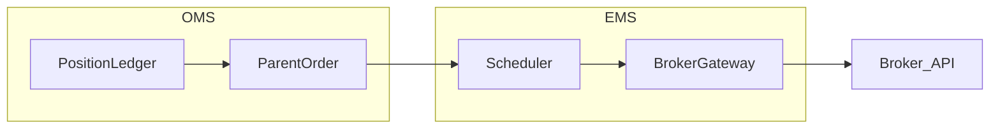

# OMS, EMS, and order routing

For class names (`InstitutionalOMS`, `EMSParentRunner`, `AlpacaExecutionAdapter`, …) and env vars, see [Execution: OMS, EMS, live desk](../documentation/oms-ems.md).

## Order management (OMS)

The **OMS** owns the **business lifecycle** of orders:

- **Parent orders** — what the portfolio manager *intends* (e.g. “buy \$1M SPY vs arrival price”).
- **State machine** — accepted → working → partially filled → done / canceled / rejected.
- **Book and reconciliation** — positions vs custodian, cash, corporate actions (conceptually).

In Shunya, **`shunya.oms`** implements an **institutional-style** parent FSM, ledger, and share reconciliation vs USD targets, with optional **Postgres** persistence.

## Execution management (EMS)

The **EMS** decides **how** parent intent becomes **child orders** on venues:

- **Scheduling** — TWAP/VWAP slices, participation rates.
- **Venue and order type choice** — market vs limit vs peg, odd lots, etc.
- **Microstructure guardrails** — price limits relative to micro-price, throttles.

Shunya **`shunya.ems`** provides **`BrokerGateway`** / **`AlpacaBrokerGateway`**, schedulers, and **`EMSParentRunner`** for child lifecycle.



## From signal to order (conceptual chain)

1. **Alpha / model** produces scores or desired weights.
2. **Portfolio construction** turns scores into **target weights or notionals**.
3. **Risk** vets or scales targets (**`PortfolioRiskEngine`**).
4. **OMS** turns targets into **parent orders** and tracks state.
5. **EMS** splits parents into **children** and sends them to the **broker API**.
6. **Broker** matches, fills, and reports executions back for reconciliation.

Shunya’s HTTP **`POST /trade/paper/cycle`** exercises a **subset** of this chain for **paper** accounts when Alpaca is enabled. A separate, discrete path — **`POST /trade/orders`** — lets a manual desk place a single parent order (market or limit) outside a rebalance cycle, tracked by its own process-wide OMS instance. Manual parent ids receive an EMS-shaped `client_order_id` (`{parent_id}:0`) so fills trace through the same code path as EMS children. Positions are never stored locally — `GET /trade/positions` always reads Alpaca directly and annotates with local working-order exposure, avoiding a second, driftable source of truth.

## Alpaca order types (overview)

Alpaca supports multiple **equity order types** and parameters; exact flags evolve with the broker API. Typical categories:

| Type | When it is used |
|------|-----------------|
| **Market** | Max certainty of fill; pay spread / impact. |
| **Limit** | Price cap/floor; non-marketable rests in book. |
| **Stop / stop-limit** | Trigger on price; used for exits or breakout entries. |
| **Trailing stop** | Stop price follows favorable movement. |

Authoritative, up-to-date detail: [Alpaca trading API docs](https://docs.alpaca.markets/docs/trading/orders).

## Order types explained: when to use which

- **Market** — highest certainty of a fill, immediately. You pay whatever the current spread and depth cost you; use it when getting done matters more than price (small size, liquid names, urgent exits).
- **Limit** — you set a price cap (buy) or floor (sell); if the market never reaches it, the order simply never fills. Use it when price matters more than certainty, or to avoid crossing a wide/illiquid spread by accident.
- **Stop / stop-limit** — dormant until price trades through a trigger, then becomes a market (stop) or limit (stop-limit) order. Typical uses: a downside exit on a long position, or a breakout entry once price clears resistance. A stop-limit can fail to fill if price gaps through the limit; a plain stop cannot (it becomes a market order and always transacts, at whatever price is available).
- **Trailing stop** — a stop price that follows the market in your favor (up for a long's trailing-sell, down for a short's trailing-buy) but never moves against you. Used to lock in gains without picking an exact exit price ahead of time.

## Working orders, partial fills, and reconciliation

An order is **working** once the broker has accepted it and it isn't yet done — it can still be fully filled, partially filled, canceled, or rejected. In Shunya's parent FSM (`shunya/oms/parent_fsm.py`) this is the `WORKING` / `PARTIAL_FILL` state range, distinct from the terminal states `FILLED`, `CANCELED`, `REJECTED`.

A **partial fill** happens when only some of the ordered quantity executes before the rest is canceled, expires, or keeps working. Fills are immutable, append-only records (`ExecutionFill` in `shunya/oms/fills.py`), each carrying its own price and quantity; a parent order's realized average price is the **volume-weighted average price (VWAP)** across its own fills — `vwap_avg_price()` sums `price × quantity` over the fills and divides by total quantity filled. This is why average fill price can differ from any single trade's price once an order is worked in slices.

Because an order can be partially filled while more of the same parent is still working, "how many more shares do I need to send" is not just `target − current position` — it must also account for shares already in flight. Shunya computes this per symbol as:

```
D_k = T_k - (P_k + W_k^buy - W_k^sell)
```

(`required_delta_shares` in `shunya/oms/reconciliation.py`), where `T_k` is the target share count, `P_k` is the **settled** position (from the broker, post-fill), `W_k^buy` is shares currently working to buy, and `W_k^sell` is shares currently working to sell. Subtracting working buys and adding back working sells prevents double-ordering: if you already have a 500-share buy working, you don't need another 500-share buy just because the position hasn't settled yet. A positive `D_k` means "buy more"; negative means "sell."

## Slippage and market impact

**Slippage** is the difference between the price you expected (e.g. at the moment you decided to trade) and the price you actually got. **Market impact** is the portion of slippage you cause yourself: a large order consumes the best-priced liquidity first, so later shares in the same order fill at worse prices — the more you demand at once, the more you move the price against yourself.

Sending one large market order for the full parent quantity maximizes impact. Splitting it into smaller **child orders** (Shunya's EMS layer) spreads that demand over time so each slice consumes less of the available liquidity, which is the core reason execution algorithms exist. `shunya/ems/schedules.py` provides two slicing strategies: `twap_slice_quantities` splits a quantity evenly across time bins (lot-size aware, remainder folded into the last bin); `vwap_slice_quantities` instead weights each bin by an expected volume profile, so more shares are sent when the market is naturally more liquid.

Within each slice, `shunya/ems/micro_price.py`'s `MicroPriceUrgency` controls how aggressively the child order chases a fill against the current L1 quote: `MID` pegs to the bid/ask midpoint (patient, no spread paid), `PASSIVE_TOUCH` joins the near-side of the book (still no spread paid, but not ahead of the queue), and `CROSS` pays the full spread to guarantee an immediate match. `EMSParentRunner` escalates a slice through these levels — starting passive, crossing only if a slice doesn't fill in time — trading a small amount of urgency for a large reduction in average impact.

## TWAP/VWAP benchmarks, pedagogically

**TWAP** (time-weighted average price) and **VWAP** (volume-weighted average price) are both a benchmark to measure execution quality against *and* a scheduling strategy for generating it. As a benchmark, TWAP is the simple average price over the execution window; VWAP is the average price weighted by how much volume traded at each price — "beating VWAP" means your average fill price was better than the market's own volume-weighted average over the same period (lower for a buy, higher for a sell).

As a scheduling strategy, slicing your order to *track* the volume profile (VWAP scheduling) or to spread evenly over time (TWAP scheduling) is a reasonable way to *achieve* something close to that benchmark, because you're buying/selling roughly in proportion to how much natural liquidity is available at each point — this is the **participation rate** idea: instead of committing to a fixed slice size, you size each slice as a fraction of expected concurrent market volume, so a bigger, more liquid market absorbs more of your order without moving price as much.

## Further reading

- [Pipeline: alpha to execution](pipeline-alpha-to-execution.md)
- [Paper trading cycle (API)](../how-to/paper-cycle-api.md)
- [Risk management and avoiding losses](risk-management-and-avoiding-losses.md)
