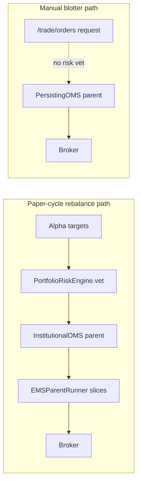

# Risk management and avoiding losses

This page is about **not losing money you didn't mean to risk**: what Shunya actually checks for you before and during trading, what it does not check, and general practice that applies whether or not the platform enforces it.

## What the platform enforces vs. your own responsibility

| Platform enforces (when wired in) | Your responsibility |
|---|---|
| Gross/single-name/sector exposure caps in the rebalance path (`PortfolioRiskEngine`) | Choosing sane limits in the first place |
| ADV participation and turnover caps on the rebalance path | Sizing manual orders sensibly — the manual path has **no** automatic caps |
| Idempotent fills, crash-safe rehydration of order state | Watching your account for orders/fills you didn't expect |
| Read-only PAPER/LIVE badge reflecting real API config | Knowing whether you're actually trading with real money |
| Reconciliation math so you don't double-order | Reconciling your own mental model against `GET /trade/positions` before assuming it's accurate |

## Pre-trade risk checks (PortfolioRiskEngine)

`PortfolioRiskEngine.vet()` applies limits from `RiskVetConfig` (`shunya/algorithm/risk_engine.py`) to portfolio-construction targets **before** they become OMS parent orders. Fields, and why each matters:

- **`max_gross_fraction_of_equity`** — caps total gross exposure (`sum|target_i|`) as a multiple of account equity. Prevents leverage from creeping up unnoticed as position count or conviction grows.
- **`max_gross_book_usd`** — an absolute USD gross cap, combined with the fraction cap via `min()` when both are set. A hard ceiling independent of how equity has moved.
- **`max_single_name_fraction`** — caps the largest single-name exposure as a fraction of equity, enforced by scaling all targets down together. Limits the damage a single bad idea or data error can do.
- **`max_adv_fraction`** — caps the size of a *trade* (the delta, not the position) relative to a name's average daily volume. Keeps you from becoming your own market impact problem, or from an order that can't realistically fill without moving the price a lot.
- **`max_turnover_fraction`** — caps how much of the book can change in one rebalance. Limits transaction-cost bleed from overtrading and controls how fast risk can change.
- **`sector_gross_cap_fraction` / `sector_net_cap_fraction`** — caps gross and net exposure per sector. Stops uncorrelated-looking alpha names from quietly concentrating into one factor bet.
- **`constraints_on_breach`** — `"rescale"` (default: scale targets down to fit) or `"raise"` (fail loudly instead of silently shrinking the trade). Choose `"raise"` if a silently smaller trade than intended would itself be a problem.
- **`vol_target_annual`** / **`portfolio_vol_scale`** — scale targets to hit an annualized volatility target, or apply a manual scalar on top. Lets you size a portfolio to a risk budget rather than a fixed dollar amount.
- **`use_cvxpy`** — if installed, solves exposure/sector/turnover constraints jointly as a QP instead of applying caps sequentially; sequential caps can interact in ways a joint solve avoids, at the cost of an extra dependency.

**This only runs on the portfolio-construction → OMS rebalance path** (`InstitutionalPaperDesk`, the `POST /trade/paper/cycle` flow). The manual order-entry path (`POST /trade/orders`, the `/trade/blotter` UI) does **not** call `PortfolioRiskEngine` at all — the only checks there are Alpaca's own asset validation (tradable/fractionable/shortable) and whatever Alpaca itself rejects. A fat-fingered quantity or price on a manual order will not be caught by Shunya.

## Position sizing and lot sizing

`max_single_name_fraction` bounds position size at the portfolio level; at the order level, EMS slicing (`shunya/ems/schedules.py`) is lot-size aware — quantities are floored to a configured `lot_size` per slice, with any remainder folded into the final slice so the total still matches the intended quantity. Odd lots and fractional shares behave differently across brokers; check `AlpacaExecutionAdapter.validate_asset` (fractionable/shortable flags) before assuming a size will be accepted as requested.

## Sentinel kill-switch and drawdown-from-HWM (Live cockpit)

A common institutional safety pattern is a **drawdown-from-high-water-mark kill-switch**: track the highest equity value seen so far (the high water mark), compute current drawdown as `(HWM − equity) / HWM`, and automatically stop trading (or force flat) if drawdown exceeds a threshold — the idea being that a strategy that's already lost a lot is more likely to be broken than "due for a bounce."

The Live cockpit page (`/live`) has a **Sentinel** control that visualizes this concept — but as implemented today it is a **client-side simulation only**. Confirming the kill-switch just sets a flag in `localStorage` (`ui/src/lib/tradeDeskStore.ts`, `setSentinel`); the confirmation dialog itself says "(sim)." It does **not** cancel real EMS child waves, does **not** read a real high-water mark from your Alpaca account, and does **not** stop the manual order-entry path. Treat it as a UI mockup of a control you'd want, not a live safety net, until it's wired to the real OMS/EMS.

## Mock vs. real risk UI

| Surface | Backed by | What that means |
|---|---|---|
| **Risk command center** (`/risk`) | Client-side state only, no backend persistence | Limits you set here do nothing to real orders |
| **Live cockpit Sentinel** (`/live`) | `localStorage` via `tradeDeskStore.ts`, simulated | Kill-switch does not cancel real orders (see above) |
| **Portfolios workspace** (`/portfolios`) | `localStorage` via `tradeDeskStore.ts` | Blend weights and the "virtual ledger" are a planning sandbox, unrelated to real Alpaca positions |
| **`PortfolioRiskEngine`** | Real, Python-side | Actually enforced, but only on the paper-cycle rebalance path — not the manual blotter |
| **`/trade/positions`, `/trade/orders`** | Real, Alpaca-backed | Actual account state; always the source of truth over any client-side view |

## General prudent-trading guidance

- **Unfilled orders still count.** A working buy order reduces your effective ability to place another buy of the same size even though it hasn't settled — this is exactly what the reconciliation formula (`W_k^buy`, `W_k^sell`) accounts for. Don't reason about risk using settled position alone.
- **Reconcile before you trust a view.** Prefer `GET /trade/positions` (live from Alpaca, annotated with working exposure) over any cached or client-side number when deciding what to do next.
- **Diversify deliberately, not by accident.** Uncorrelated-looking names can still share a sector or factor exposure; the sector caps above exist because gross/single-name caps alone don't catch this.
- **Set your own drawdown limit and honor it manually** until Sentinel is wired to real order cancellation — decide in advance what loss level makes you stop trading, and don't rely on the UI to enforce it for you.
- **Pattern Day Trader (PDT) rule** — US equity accounts under $25k equity are limited to 3 day trades (open+close same session) in a rolling 5 business days; violating it can freeze the account. This is a regulatory/broker constraint, not something Shunya checks — verify your account status with Alpaca before frequent intraday round trips.
- **Know which mode you're in.** The PAPER/LIVE badge on the blotter is read-only and reflects `SHUNYA_ALPACA_PAPER` on the API — confirm it before placing size you wouldn't want filled for real.

## Further reading

- [OMS, EMS, and order routing](oms-ems-and-order-routing.md)
- [Portfolio construction and risk (code)](../documentation/portfolio-risk.md)
- [Trade area (UI)](../ui/trade.md)
