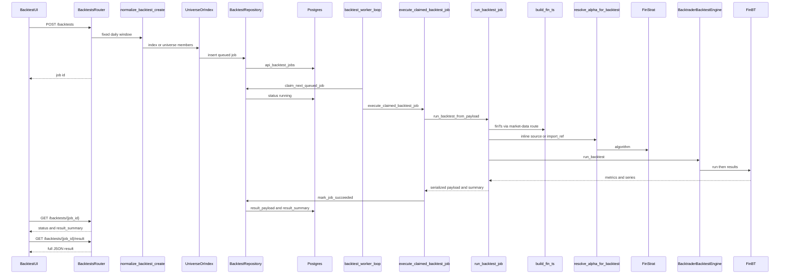

# Asynchronous backtest sequence

Happy path for a UI or API backtest. The worker loop starts in the API process lifespan. It is not a separate OS process unless you deploy one yourself.

`GET /backtests/{job_id}` returns status and `result_summary`. The chart payload is `GET /backtests/{job_id}/result` after `succeeded`.

Notifications on this path use `backtest.queued`, `backtest.started`, and `backtest.succeeded`. A failed job stores `error_code` from `shunya.errors.ErrorCode` and publishes that same code.

Library-only `FinBT` calls skip the queue. See [Signals: FinStrat and FinBT](finstrat-finbt.md) and [Ports and adapters](../reference/ports-adapters.md).
