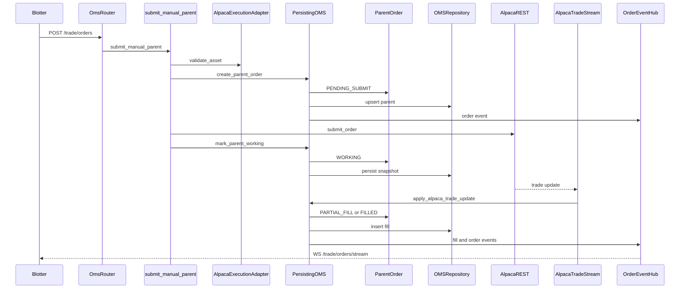

# Manual order sequence

Happy path for a blotter order (`POST /trade/orders`). This path checks that Alpaca knows the asset, then submits one order. It does not call `PortfolioRiskEngine` and it does not run `EMSParentRunner` or TWAP/VWAP slicing. Those steps belong to `POST /trade/paper/cycle` via `InstitutionalPaperDesk`.

The manual parent id is still formatted as an EMS child id (`{parent_id}:0`) so fill events parse the same way.

Position rows on `GET /trade/positions` come from Alpaca `get_all_positions()`, annotated with working buy and sell quantity from the in-memory ledger.

Cancel (`DELETE /trade/orders/{parent_id}`) calls Alpaca `cancel_order_by_id` and leaves the local terminal state to the trade stream.

Startup `rehydrate` reloads open parents and reconciles missed fills from Alpaca REST. That path is not part of the submit sequence above.

See [OMS, EMS, and the live desk](oms-ems.md) for the two OMS instances and [HTTP behavior beyond OpenAPI](../reference/http-beyond-openapi.md) for the socket frames.
