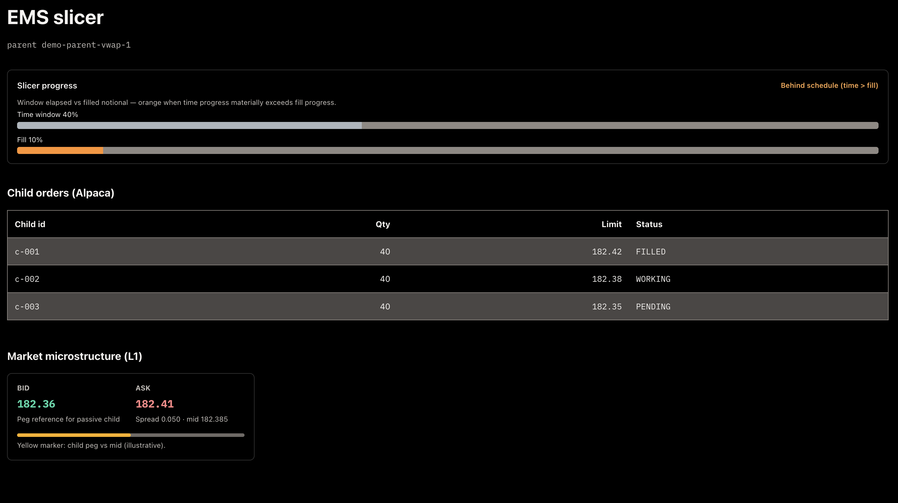
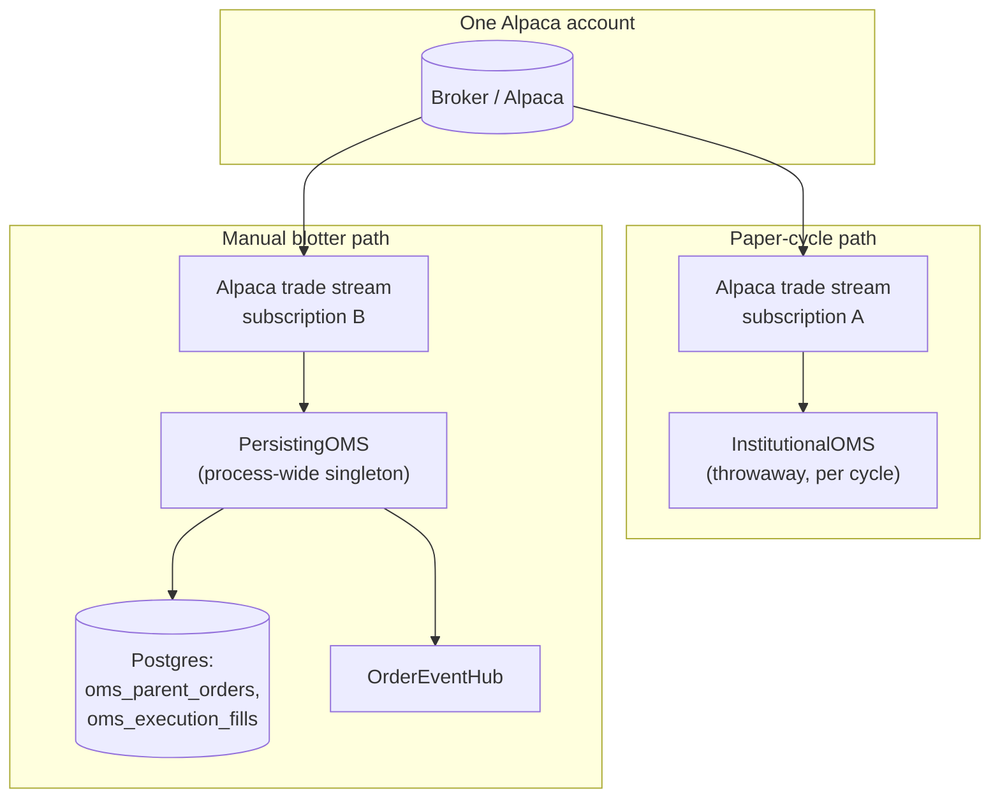

# Execution: OMS, EMS, and live desk

## OMS (`shunya.oms`)

The **OMS** layer models institutional parent orders: parent-order FSM, in-memory ledger, share reconciliation versus USD targets, Alpaca stream and REST helpers, and optional **Postgres** persistence (`shunya/oms/db`) with **Alembic** migrations under `alembic/versions/`.

## EMS (`shunya.ems`)

The **EMS** schedules and routes child orders: **`BrokerGateway`** / **`AlpacaBrokerGateway`**, TWAP/VWAP-style schedulers, micro-price limit helpers, and **`EMSParentRunner`** for child lifecycle.

The **web UI** exposes an **Execution hub** route that visualizes slicer progress, child order rows, and a compact L1 card (demo / mock state may apply until more live EMS APIs exist). See [Trade area → Execution](../ui/trade.md).



## Alpaca integration

Low-level helpers **`AlpacaExecutionAdapter`** and **`OrderManager`** translate signed USD deltas into orders and cache open-order state across **your** rebalance loop. There is no bundled tick-to-trade runner; you connect these behind a scheduler or service.

**Environment and clients:** use `shunya.integration.alpaca_settings` (`AlpacaRuntimeSettings`, `load_alpaca_settings_from_env`, `build_trading_client`, `build_stock_historical_data_client`, `build_trading_stream`) so credentials and paper mode stay consistent.

Typical keys: `APCA_API_KEY_ID` / `APCA_API_SECRET_KEY`, optional `SHUNYA_ALPACA_*` aliases, and **`SHUNYA_ALPACA_PAPER`** (defaults to paper).

## `InstitutionalPaperDesk`

**`InstitutionalPaperDesk`** (`shunya.live.desk`) wires **PortfolioConstructionService** (or fixed USD targets) → **`PortfolioRiskEngine`** → **`InstitutionalOMS`** → **`EMSParentRunner`** with **`AlpacaOMSTradeStream`**.

## CLI: `shunya-paper`

From a clone with the appropriate extras:

```bash
uv run shunya-paper paper-cycle --date YYYY-MM-DD [--capital N] [--demo | --pcs-factory module:fn]
```

See the repository **README** for full flags and examples.

## HTTP trade desk

The FastAPI app exposes **`POST /trade/paper/cycle`** for a single paper cycle when Alpaca and the trade-desk token are enabled. See [Paper trading cycle (API)](../how-to/paper-cycle-api.md) and the [HTTP API (overview)](../reference/http-api-package.md).

## Manual order entry (`api/routers/oms.py`)

A second, **process-wide** `InstitutionalOMS` singleton (persisted to Postgres via `shunya.oms.db.repository.OMSRepository`) backs discrete manual order placement, separate from the per-cycle OMS instance `InstitutionalPaperDesk` builds for rebalances. Both subscribe independently to the Alpaca trade-update stream; `InstitutionalOMS.apply_alpaca_trade_update` no-ops for parent ids it doesn't own, so the two ledgers never cross-contaminate. Manual parent orders use the EMS `client_order_id` convention (`{parent_id}:0`) so they trace through the same `parent_id_from_client_order_id` parsing as EMS children.

Endpoints (all behind `X-Shunya-Trade-Desk-Token`): `POST /trade/orders`, `DELETE /trade/orders/{parent_id}`, `GET /trade/orders`, `GET /trade/orders/{parent_id}`, `GET /trade/orders/{parent_id}/fills`, `GET /trade/fills`, `GET /trade/positions` (derived live from Alpaca `get_all_positions()`, annotated with our own working buy/sell — no local positions table), and a live order/fill stream at `WS /trade/orders/stream?token=...`.

The **web UI** exposes a real order-entry + blotter page at **`/trade/blotter`**, and the Execution hub/tracer routes now render real parent/fill data instead of mock state.

### Two independent OMS singletons

There are **two separate `InstitutionalOMS`-family instances alive in the same process**, and they do not share state:

1. **`InstitutionalPaperDesk`** (`shunya/live/desk.py`) builds a fresh, throwaway `InstitutionalOMS` for each paper cycle (`POST /trade/paper/cycle`).
2. **`PersistingOMS`** (`api/services/oms_runtime.py:58-141`, a `InstitutionalOMS` subclass) is built **once** at API startup by `build_oms_runtime` and lives for the process lifetime, backing the manual order-entry/blotter surface.

Both subscribe independently to the **same** Alpaca account's trade-update stream. `InstitutionalOMS.apply_alpaca_trade_update` no-ops for any `parent_id` it doesn't recognize, so a fill for a paper-cycle parent is silently ignored by `PersistingOMS` and vice versa — there's no cross-contamination, but also no shared view: a position opened via the manual blotter is invisible to the paper-cycle OMS's own ledger (both still read the **same real Alpaca positions** via REST when asked, since neither stores positions locally).



### Startup rehydration and reconciliation

`PersistingOMS` is durable across process restarts. At startup, `rehydrate(runtime, trading_client)` (`api/services/oms_runtime.py:199-251`):

1. Loads all non-terminal parent rows from Postgres (`OMSRepository.list_open_parents`) and replays each into a fresh `ParentOrder` FSM (`broker_accept()` if already past `PENDING_SUBMIT`, `apply_fill()` if partially filled) — reconstructing in-memory ledger state a restart would otherwise lose.
2. For each rehydrated parent with a known `broker_order_id`, fetches the order from Alpaca REST (`get_order_by_id`) and reconciles: applies any fills that happened while the process was down, marks `CANCELED`/`REJECTED` if the broker shows that status, and persists the reconciled snapshot.
3. Finally calls `refresh_settled_shares_from_alpaca` so working-vs-settled math (`required_delta_shares`) starts from a correct baseline.

Fill inserts are idempotent on `trade_id` (`OMSRepository.insert_fill_idempotent`, Postgres `ON CONFLICT DO NOTHING`), so replaying a trade update that was already recorded before a restart is safe.

### Event fan-out: OrderEventHub

The Alpaca SDK delivers trade-update callbacks on its own thread/loop, not necessarily the API's event loop. `OrderEventHub` (`api/services/oms_event_hub.py`) bridges this safely:

- `publish_threadsafe(payload)` — callable from any thread — uses `loop.call_soon_threadsafe` to enqueue onto a bounded `asyncio.Queue` (`maxsize=1000`); if full, the oldest queued event is dropped to make room rather than blocking the publisher.
- A `_drain` task (started by `bind_loop` at lifespan startup) pulls off the queue on the API's own event loop and calls `publish`, which fans out to every attached `WebSocket` under a lock, detaching any socket whose `send_json` fails.

The module docstring is explicit about why this shape was chosen: calling the async `publish` directly via `run_coroutine_threadsafe(...).result()` from a non-loop thread can deadlock if that thread turns out to be the loop's own thread under some SDK internals — `call_soon_threadsafe` avoids that class of bug entirely.

`PersistingOMS` publishes two event shapes: `{"type": "order", "order": {...}}` on create/working/trade-update, and `{"type": "fill", "fill": {...}}` on `record_fill`. Clients receive these over `WS /trade/orders/stream`.

### Manual order services

`api/services/oms_orders.py` is the thin service layer the router calls into:

- **`submit_manual_parent`** — validates the asset via `AlpacaExecutionAdapter.validate_asset`, registers the parent in the ledger **before** calling Alpaca (so a fast fill arriving on the trade-update stream always finds an owning parent), submits the order, and on success calls `mark_parent_working` + persists order_type/limit_price/time_in_force/`origin="manual"`. On an Alpaca `APIError`, marks the parent rejected instead.
- **`cancel_manual_parent`** — looks up the stored `broker_order_id` and calls `cancel_order_by_id`. It deliberately does **not** force local state to `CANCELED` — the Alpaca trade-update stream remains the single writer of terminal state, so the UI shows the order as still working until the broker confirms the cancel.

### New schema fields (migration 002)

`alembic/versions/002_oms_parent_order_fields.py` adds to `oms_parent_orders`:

| Column | Purpose |
|---|---|
| `order_type` | `"MARKET"` / `"LIMIT"` as submitted by `OmsOrderPlaceRequest`. |
| `limit_price` | The limit price, when `order_type` is `"LIMIT"`. |
| `time_in_force` | `"DAY"` or `"GTC"`, as submitted to Alpaca. |
| `broker_order_id` (indexed) | Alpaca's own order id; used to look up/cancel/reconcile against the broker. |
| `updated_at` | Last snapshot write time. |
| `origin` | Provenance tag; currently always `"manual"` for orders placed via `api/routers/oms.py` — reserved for distinguishing sources if more are added later. |

## Known limitations

- **TWAP/VWAP slicing is not wired into `/trade/orders`.** The manual path submits a single order directly to Alpaca; `EMSParentRunner` and the `shunya/ems` schedulers are only exercised by the algorithmic paper-desk path (`InstitutionalPaperDesk`), not by manual blotter orders.
- **Settled positions are always sourced from Alpaca REST**, never computed independently from locally recorded fills — there is no local position ledger to drift out of sync, but also no offline view if the broker API is unreachable.
- **No multi-broker or multi-account support** — one `TradingClient` / `TradingStream` per process, Alpaca only.
- **No order amend/replace** — only cancel is exposed; an urgency-attempt suffix in the EMS child-order-id scheme supports internal cancel/reissue, but there's no user-facing "modify this order" endpoint.
- **Minimal audit trail** — `origin` is the only provenance field; there is no per-user/account attribution on manual orders.

## Further reading

- [Manual order sequence](manual-order-sequence.md) — blotter submit through fill.
- [OMS, EMS, and order routing](../concepts/oms-ems-and-order-routing.md) — finance and architecture view.
- [Risk management and avoiding losses](../concepts/risk-management-and-avoiding-losses.md) — what is and isn't checked before an order goes out.
