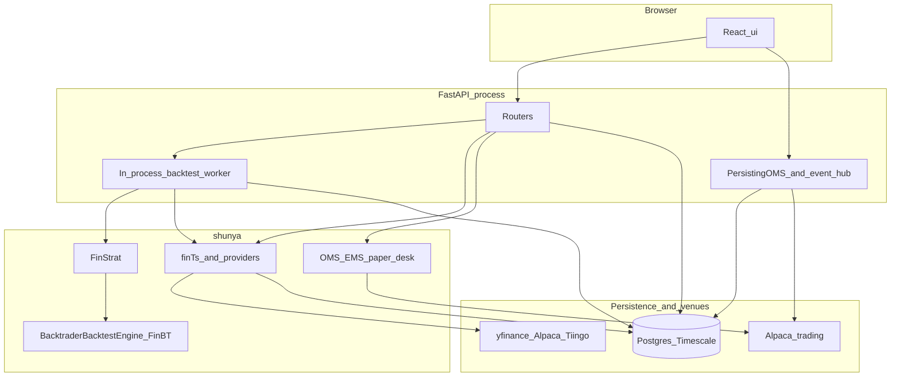

# System overview

**Shunya** is a Python-first stack for **systematic equity research**: multi-ticker OHLCV panels, JAX-friendly alpha code (**FinStrat** / `cross_section`), **backtrader** simulation (**FinBT**), portfolio construction, optional pre-trade risk, institutional-style **OMS** / **EMS** building blocks, optional **TimescaleDB** storage, and a repo-local **FastAPI** service with a **React** web app in `ui/`.

## Components

| Layer | Role |
|-------|------|
| **`shunya` (PyPI `shunya-py`)** | Library: `finTs`, `FinStrat`, `FinBT`, portfolio services, OMS/EMS, providers, operators. |
| **`api/`** | FastAPI app in the **`shunya-py`** wheel (install **`[api]`**). Alphas, async backtests, data and market routes, optional trade desk. The backtest worker runs inside this process by default. |
| **`ui/`** | Vite + React client: Alpha Studio, backtests, dashboards, trade surfaces (some live, some mock until more HTTP routes exist). |
| **Postgres / Timescale** | Optional durable OHLCV, API job queue, dashboard aggregates, runtime config overlay. |

## High-level design

The default deployment is one API process. Its lifespan starts the backtest worker task and, when Alpaca is enabled, the manual OMS runtime and trade stream. The React app talks to that process over HTTP and WebSocket.

- In dev, Vite proxies `/api` to uvicorn.
- Backtest jobs are rows in Postgres. The worker claims them in this process.
- Manual blotter orders use `PersistingOMS`. Paper-cycle rebalance uses a separate `InstitutionalOMS` inside `InstitutionalPaperDesk`.
- Sequences: [manual order](manual-order-sequence.md), [asynchronous backtest](backtest-sequence.md).

## Layering and ports

For how adapters, ports, and API error mapping stay decoupled from engines, see [ADR 001: layering](../adr/001-architecture-layers.md).

## Where to read next

- [Data layer: finTs and providers](fints-providers.md) — data contracts and provenance.
- [Signals: FinStrat and FinBT](finstrat-finbt.md) — signal to simulation.
- [HTTP API (overview)](../reference/http-api-package.md) — route groups and OpenAPI.
- [Python reference](../reference/index.md) — generated symbols by domain.
- [Glossary](../glossary.md) — short definitions of terms used across the docs.
- [Concepts (finance)](../concepts/index.md) — quantitative background and how it maps to this stack.
