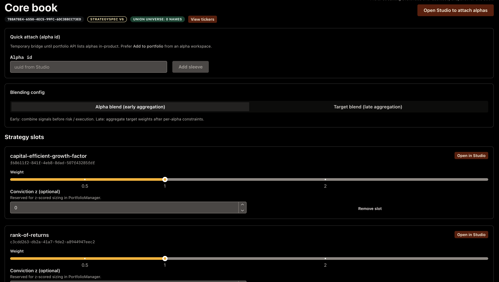
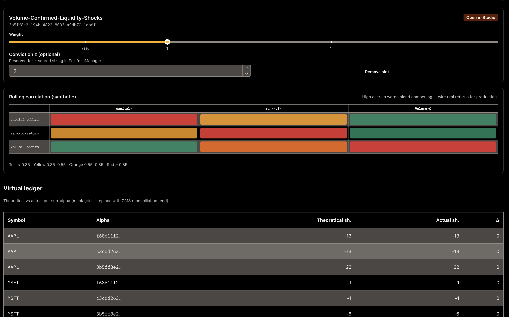
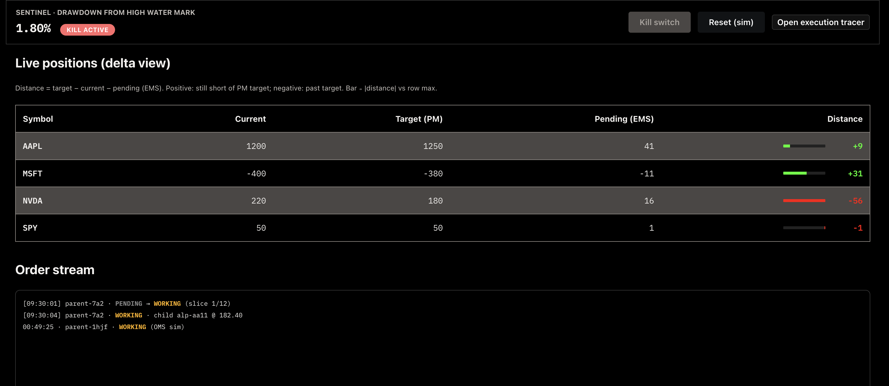
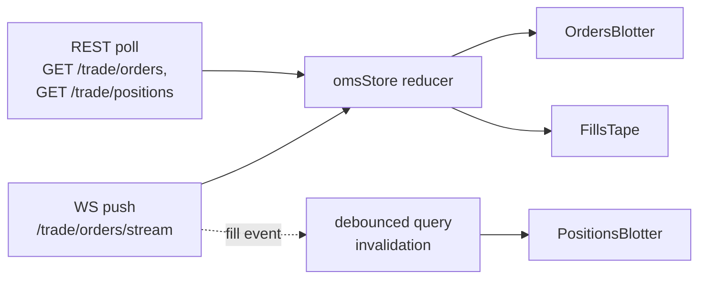
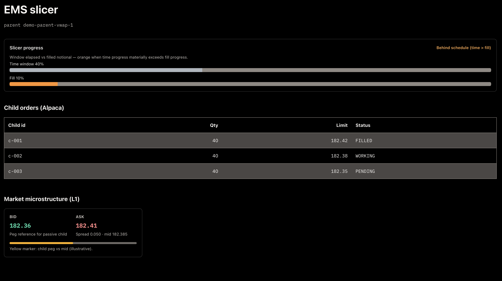

# Trade area (sidebar)

## Portfolios (`/portfolios`, `/portfolios/:id`)

Portfolio workspace: blend configurations and weights. State may combine API data with client-side persistence depending on route coverage; consult `ui/src/hooks/useTradeDesk.ts` and related components for current behavior.

Blend modes, quick attach by alpha id, and per-alpha weights (example **Core book** workspace):

Rolling correlation (synthetic overlap warning) and **virtual ledger** (mock grid until OMS reconciliation is wired):

## Live (`/live`)

Cockpit-style strip for live-style monitoring (layout oriented to trading workflows). **Sentinel** surfaces drawdown-from-high-water-mark, kill/reset controls, target vs current vs pending deltas, and an order stream (much of the desk still mixes **mock / `localStorage`** state with live API calls depending on route coverage).

## Account (`/trade/account`)

When the API has **`SHUNYA_API_ALPACA_ENABLED`** and keys configured, the UI can call:

- Equity snapshot
- Portfolio history
- Activities
- Account configurations (get/patch)

Send header **`X-Shunya-Trade-Desk-Token`** matching **`SHUNYA_API_TRADE_DESK_TOKEN`** on the API (paste the same value in **Settings** where provided). Without Alpaca + token, these calls fail or are gated by the API.

## Blotter (`/trade/blotter`)

Manual paper order entry (market/limit) plus a live order/position/fill blotter, backed by the process-wide manual OMS singleton and its Postgres persistence. Requires the same **`X-Shunya-Trade-Desk-Token`** as the Account page; the live order/fill stream additionally requires the token as a `?token=` query param (`WS /trade/orders/stream`). A read-only **PAPER**/**LIVE** badge reflects the API's `SHUNYA_ALPACA_PAPER` setting — there is no UI toggle.

### Data flow: REST + WS hybrid freshness

The blotter combines a polled REST source of truth with a live WebSocket push, rather than relying on either alone:

- **`OrderEntryForm`** — write-only: `POST`s an order, then invalidates the orders query on success. Has no direct WS role beyond showing the PAPER/LIVE badge from stream state.
- **`OrdersBlotter`** — merges two sources by `parent_id`: a 15s-interval REST poll (`GET /trade/orders`) and live order events from the WS reducer (`ui/src/live/omsStore.tsx`); WS entries patch/overwrite the corresponding REST row so the table updates immediately on a state change without waiting for the next poll.
- **`PositionsBlotter`** — purely REST-polled (`GET /trade/positions`, 10s interval); there is no dedicated positions-stream endpoint, so freshness on fills is achieved indirectly: a `fill` event on the WS schedules a debounced (500ms) invalidation of the positions query, prompting an early re-fetch instead of waiting out the poll interval.
- **`FillsTape`** — pure WebSocket consumer: renders a capped ring buffer (500 entries) of fill events from the reducer, with no REST backing at all — if the socket disconnects, the tape simply stops growing until it reconnects.

The same reducer-plus-WebSocket shape (without the REST-poll layer) is reused by `ui/src/live/l1Store.tsx` for per-symbol L1 quote/trade streaming on the Execution tracer and Instrument detail pages.

### Trade-desk token gating

`useTradeDeskToken` (`ui/src/hooks/useTradeDeskToken.ts`) tracks a draft value (as you type) separately from an applied value (only set once you submit it) so requests don't fire on every keystroke; the applied token is kept in `sessionStorage`, so it is cleared when the browser tab/session ends — you'll need to re-enter it after a restart. This gate exists for developer convenience in matching the API's configured `SHUNYA_API_TRADE_DESK_TOKEN`; it is not a substitute for real authentication/authorization.

## Execution (`/execution`, `/execution/:parentId`)

**Execution hub** lists recent manually-placed orders (via `GET /trade/orders`, requires an applied token) plus a "recently viewed" convenience list from local state. **Execution tracer** renders real parent order + fill data (`GET /trade/orders/{id}`, `GET /trade/orders/{id}/fills`) and an optional live L1 microstructure panel for the order's symbol — no more fabricated demo data.

## Risk (`/risk`)

**Risk command center** — limits and diagnostics UI backed by mock/local state in the same sense as Execution until server routes are expanded.

## Paper cycle (API)

One-shot institutional paper cycle is available at **`POST /trade/paper/cycle`** (not a full duplicate of the Account page). See [Paper trading cycle (API)](../how-to/paper-cycle-api.md).

## See also

- [OMS, EMS, and order routing](../concepts/oms-ems-and-order-routing.md) (finance) and [Execution: OMS, EMS](../documentation/oms-ems.md) (code)
- [HTTP API (overview)](../reference/http-api-package.md)
